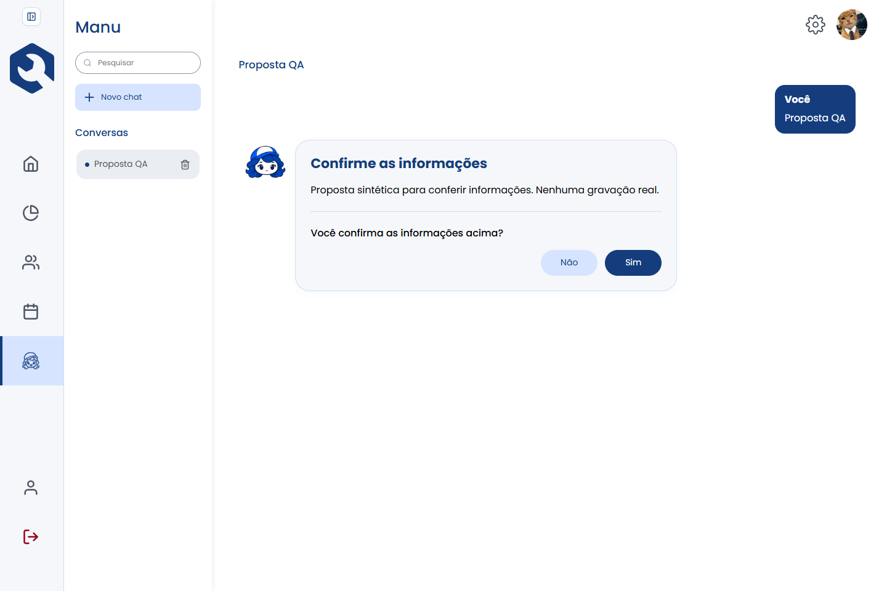
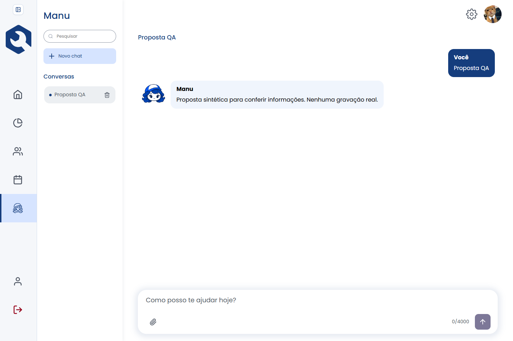

# Auditoria adversarial da Manu - 27/10/2026

> Atualização posterior da Web: WEB-01 a WEB-04 foram corrigidos e validados na [revisão de correções](CORRECOES_WEB_2026-10-27.md). O PDF e as evidências abaixo preservam o estado observado na coleta original.

Relatório para a equipe da IA e da Web. Atividade vinculada à [Issue #12](https://github.com/Fixa-Inter/segundo-aplicacao-website/issues/12). Responsável: Gkso31, com execução assistida pelo Codex. Nenhum código da IA ou fluxo de produção da Web foi alterado para esta auditoria.

## Resultado e prioridade

Foram executados **72 casos dirigidos**: 39 requisições de ensaio à IA na AWS, 2 logins na API Web, 14 casos do adaptador com transporte controlado e 17 casos na interface com respostas controladas. As repetições do roteiro durante o ajuste de seletores não foram contadas de novo. Limpeza de conversas e consultas de contrato não entram nessa contagem. Os 25 testes existentes de integração da Manu também passaram antes dos ensaios.

Os resultados foram agrupados em **11 pontos de correção**: 5 observados na AWS, 2 lacunas do contrato de histórico reproduzidas na Web e 4 problemas de robustez da Web. Há falhas funcionais, lacunas de contrato e endurecimento de validação; não são 11 vulnerabilidades de segurança. As expectativas do roteiro são propostas de comportamento seguro e consistente com o produto, mesmo quando o OpenAPI atual é mais permissivo.

**Corrigir primeiro INT-01**, que faz desaparecer a confirmação de uma proposta ao recarregar a página. Em seguida, alinhar o ciclo de vida das sessões e as validações entre Web e API. P1 significa prioridade funcional alta; P2, prioridade normal; P3, melhoria de acabamento/contrato. A escala não é CVSS.

| ID     | Prioridade | Responsável                                      | Ponto                                                                          | Evidência               |
| ------ | ---------- | ------------------------------------------------ | ------------------------------------------------------------------------------ | ----------------------- |
| IA-01  | P2         | API da IA                                        | Identificador com espaços causa erro 500 no encerramento                       | S07                     |
| IA-02  | P2         | API da IA                                        | Encerramento confirma sucesso para conversa inexistente ou de outra conta      | S03, S05, S06           |
| IA-03  | P2         | API da IA                                        | Conversa encerrada aceita novas mensagens                                      | C01, C02                |
| IA-04  | P2         | API da IA                                        | Validação de imagens é mais permissiva que a da Web                            | I01, I02, I03, U11, U12 |
| IA-05  | P3         | API da IA                                        | Resumo não fornece um título curto separado                                    | C01                     |
| INT-01 | P1         | API da IA + Web                                  | Confirmação pendente desaparece ao recarregar a página                         | U07, B02                |
| INT-02 | P2         | API da IA + Web                                  | Imagens enviadas somem na reabertura pelo histórico                            | U08, B03                |
| WEB-01 | P2         | Web; contrato de saída da IA também deve validar | Resposta vazia é exibida como balão sem conteúdo                               | U01, U02, B01           |
| WEB-02 | P2         | Web                                              | thread_id inválido é aceito na resposta de criação de chat                     | U03, U04                |
| WEB-03 | P2         | Web                                              | Histórico já em memória fica inacessível ao voltar à tela com API indisponível | B04, B14                |
| WEB-04 | P3         | Web / integração Cloudinary                      | Falha de formato do upload expõe erro técnico ao usuário                       | U09, U10, B10           |

## Ambiente e rastreabilidade

- Data: 27/10/2026, America/Sao_Paulo. Início observado: 16h41m03s. Ensaio AWS: 16h52m35s a 16h54m35s. As capturas de interface foram feitas depois, com respostas controladas.
- Web local: http://localhost:5173, base Git `9e6434d`, branch `feature/integracao-ia-manu`.
- IA publicada: https://ia-api.fixa.solutions. API Web: https://web-api.fixa.solutions. Todas as chamadas autenticadas usaram `Authorization: Bearer <token>`; os DELETEs não receberam corpo.
- Perfis autorizados: Gestor e RH (ADMINISTRADOR). Senhas, tokens e headers de autenticação não estão nos arquivos entregues.
- Código-fonte da IA consultado em leitura: main `b0977fd0d25aceed468014f2092457cd08bdc665`. O serviço expõe versão 0.1.0, mas não informa SHA do deploy; não foi presumido que o código consultado é exatamente o implantado.
- Edge/Chromium headless, interface de produção com APIs interceptadas nos testes B; viewports 1440x960, 320x667 e 844x390.
- Foram criadas três conversas de QA reais. As três foram removidas ao final (RH já removida em D01); os dois DELETEs restantes de limpeza retornaram 200. Nenhuma conversa preexistente foi removida.

## IA-01 - Identificador com espaços causa erro 500 no encerramento

**P2 | API da IA | AWS real | Casos S07**

**Como reproduzir:** Com Bearer válido, enviar DELETE /api/v1/chat/sessions/%20, sem corpo.

**Resultado observado:** HTTP 500 com corpo Internal Server Error. A entrada inválida não vira um erro de validação.

**Resultado esperado:** Rejeitar o identificador vazio após trim com HTTP 400 ou 422, sem executar o encerramento.

**Impacto:** Uma entrada controlável pelo cliente produz falha interna e impede um tratamento previsível na interface.

**Correção sugerida:** Validar e normalizar o parâmetro de caminho antes do serviço. Converter ValueError em resposta 4xx. Aplicar os mesmos limites a todas as rotas de sessão.

**Aceite do reteste:** Espaço, tabulação e ID vazio após normalização retornam 4xx; um ID válido continua funcionando.

**Referência e limite da conclusão:** app/services/sessao.py: finalizar_sessao_chat; a validação de thread_id após strip lança ValueError.

## IA-02 - Encerramento confirma sucesso para conversa inexistente ou de outra conta

**P2 | API da IA | AWS real | Casos S03, S05, S06**

**Como reproduzir:** Gerar um UUID sem conversa e chamar DELETE /api/v1/chat/sessions/{uuid}. Repetir com o ID de uma conversa de QA da outra conta autorizada.

**Resultado observado:** Ambos retornaram HTTP 200, status ENCERRADA, mensagem Sessão encerrada com sucesso e resumo null.

**Resultado esperado:** Retornar 404 quando não houver conversa acessível ao usuário autenticado. Se houver política de DELETE idempotente, ela precisa ser explícita e não afirmar que houve encerramento e resumo.

**Impacto:** A Web aceita a confirmação e pode apresentar uma conversa como encerrada sem o serviço ter confirmado a operação sobre uma conversa válida.

**Correção sugerida:** Consultar a sessão por identificador e usuário antes de resumir ou responder. Manter autorização por proprietário e retornar erro uniforme para inexistente/sem acesso.

**Aceite do reteste:** Conversa própria encerra; conversa inexistente ou de outra conta retorna 404. Não retorna dados da outra conta nem modifica seu estado.

**Referência e limite da conclusão:** app/services/sessao.py e persistência de sessões. Não houve evidência de leitura ou alteração da conversa alheia: a leitura pelo dono continuou disponível e sem resumo.

## IA-03 - Conversa encerrada aceita novas mensagens

**P2 | API da IA | AWS real | Casos C01, C02**

**Como reproduzir:** Criar conversa de QA, encerrá-la pelo DELETE de chat/sessions e enviar POST /api/v1/chat com o mesmo thread_id.

**Resultado observado:** O encerramento retornou ENCERRADA com resumo. O POST posterior retornou 200, o mesmo thread_id e nova resposta: Olá! Como posso ajudar?

**Resultado esperado:** Pelo fluxo atual da Web, uma conversa salva fica somente para leitura; a API deve retornar 409 ao tentar continuar. Uma política de reabertura exigiria contrato e atualização explícita do resumo.

**Impacto:** O estado usado pela Web diverge do estado permitido pela API. O resumo pode deixar de representar as mensagens posteriores.

**Correção sugerida:** Persistir estado explícito da conversa e verificá-lo antes de invocar o grafo. Não inferir encerramento somente da existência de texto de resumo.

**Aceite do reteste:** POST em sessão encerrada é recusado sem invocar ferramentas; uma conversa nova continua aceitando mensagens.

**Referência e limite da conclusão:** app/services/chat.py: consulta a existência e o proprietário, mas não bloqueia o estado encerrado antes do grafo.

## IA-04 - Validação de imagens é mais permissiva que a da Web

**P2 | API da IA | AWS real; lacuna de validação | Casos I01, I02, I03, U11, U12**

**Como reproduzir:** Enviar uma imagem com URL file:///**fixa_qa_arquivo_inexistente**.png. Em outro envio da mesma conversa de QA, enviar quatro URLs públicas de imagem.

**Resultado observado:** As duas requisições retornaram HTTP 200 e resposta genérica fora_de_escopo. A Web rejeita protocolos fora de HTTP/HTTPS e limita a três imagens; a API aceita lista de strings sem esses limites.

**Resultado esperado:** Validar também no servidor o protocolo, a quantidade e o formato da URL. Definir uma política de origem e de limites de conteúdo antes de qualquer download.

**Impacto:** Clientes que não passam pela Web conseguem ignorar as restrições do produto. Há superfície de entrada não validada no servidor.

**Correção sugerida:** Alinhar o schema de imagens ao limite acordado de três anexos e validar URL. Se o serviço baixar imagens, proteger destino, redirecionamentos, timeout, tamanho e tipo do conteúdo.

**Aceite do reteste:** file:, javascript:, URL inválida e quatro anexos são recusados com 422; anexos válidos continuam no fluxo esperado.

**Referência e limite da conclusão:** app/schemas/chat.py: imagens é list[str], sem limite de itens/URI. Isto é endurecimento do contrato atual; não foi demonstrado SSRF, leitura de arquivo ou acesso à rede interna.

## IA-05 - Resumo não fornece um título curto separado

**P3 | API da IA | AWS real + código-fonte | Casos C01**

**Como reproduzir:** Encerrar uma conversa de teste e examinar resumo; comparar com o formatador de histórico que separa a primeira linha como titulo.

**Resultado observado:** A resposta veio em um único parágrafo, começando com O usuário informou que era um teste de integração [...]. Não havia título separado. O código de histórico usa a primeira linha como título.

**Resultado esperado:** Devolver titulo curto e resumo em campos distintos, sem depender de Markdown, primeira linha ou interpretação pela Web.

**Impacto:** O cabeçalho pode receber um parágrafo. A Web tem uma proteção que usa a primeira mensagem quando o título não é utilizável, mas isso não entrega o título do resumo solicitado.

**Correção sugerida:** Gerar saída estruturada e validada com titulo e resumo. Devolver ambos no encerramento e nas duas consultas de histórico.

**Aceite do reteste:** Um resumo de várias frases produz um titulo curto independente; o mesmo título aparece após reload. Falha ao gerar resumo não muda indevidamente o estado.

**Referência e limite da conclusão:** app/memory/persistencia/gerar_resumo.py e app/services/sessoes/historico.py; proteção atual em src/utils/manu.ts.

## INT-01 - Confirmação pendente desaparece ao recarregar a página

**P1 | API da IA + Web | Web real com contrato remoto controlado | Casos U07, B02**

**Como reproduzir:** Responder ao envio com confirmacao=sim. Verificar os botões Sim e Não. Recarregar e abrir a mesma conversa, usando o DTO atual do histórico.

**Resultado observado:** Antes do reload há proposta e botões. Depois há apenas um balão comum; Sim aparece zero vezes e o campo de mensagem volta a ficar habilitado. O histórico não informa a confirmação pendente nem a marcação da mensagem.

**Resultado esperado:** A proposta deve continuar pendente após reload, troca de dispositivo e nova sessão de navegador. Sim/Não e a correção precisam continuar associados à proposta correta.

**Impacto:** O usuário perde o caminho de revisar/confirmar uma criação. Este teste não criou registros e não prova que a API execute uma criação sem consentimento.

**Correção sugerida:** Persistir proposta, estado e identificador da ação no backend; expor estado no histórico. A Web deve restaurar os controles pelos campos remotos. A verificação de consentimento também precisa existir no servidor.

**Aceite do reteste:** Recarregar com proposta pendente preserva a revisão; dupla confirmação não duplica criação; confirmação de proposta antiga é rejeitada. A etapa com criação real deve ser homologada em ambiente de teste.

**Referência e limite da conclusão:** Contrato em src/types/api/manu.ts; src/services/manuService.ts define confirmacao=nao ao decodificar histórico. O cache só mascara a ausência enquanto a página permanece carregada.

Antes do reload (proposta simulada, sem criação real):



Depois do reload:



## INT-02 - Imagens enviadas somem na reabertura pelo histórico

**P2 | API da IA + Web | Web real com contrato remoto controlado | Casos U08, B03**

**Como reproduzir:** Enviar mensagem com uma imagem, recarregar a página e abrir novamente a conversa.

**Resultado observado:** A mensagem tinha uma imagem antes do reload e zero depois. O DTO remoto só contém role, mensagem e emocao; o adaptador define images=[] em cada mensagem.

**Resultado esperado:** O histórico deve conservar as URLs das imagens enviadas, na mensagem original e na ordem original.

**Impacto:** A conversa reaberta perde contexto visual. O usuário não consegue conferir qual foto havia enviado.

**Correção sugerida:** Persistir e devolver imagens por mensagem e mapear esses campos na Web; validar as URLs também ao ler o histórico.

**Aceite do reteste:** Uma a três imagens válidas continuam visíveis após reload e em outra sessão autenticada; uma conversa sem anexos continua funcionando.

**Referência e limite da conclusão:** src/types/api/manu.ts e src/services/manuService.ts: decodeHistory. Upload do teste foi interceptado; nenhum arquivo real foi enviado ao Cloudinary.

## WEB-01 - Resposta vazia é exibida como balão sem conteúdo

**P2 | Web; contrato de saída da IA também deve validar | Resposta defeituosa controlada | Casos U01, U02, B01**

**Como reproduzir:** Simular POST /api/v1/chat com resposta vazia ou somente espaços e os demais campos válidos.

**Resultado observado:** O serviço aceita e armazena a resposta. A tela mostra um balão com Manu e nenhum conteúdo, sem alerta. A validação atual só exige typeof resposta=string.

**Resultado esperado:** Rejeitar resposta sem conteúdo após trim, preservar o contexto e apresentar erro compreensível, sem repetir o POST automaticamente.

**Impacto:** A conversa parece ter sido respondida, mas o usuário não recebe informação nem indicação da falha.

**Correção sugerida:** Validar resposta.trim() tanto na saída da IA quanto no adaptador Web. Manter a política de não repetir ações ambíguas automaticamente.

**Aceite do reteste:** Strings vazias e em branco produzem erro legível, sem bolha vazia e sem reenvio automático.

**Referência e limite da conclusão:** src/services/manuService.ts: validação da resposta de send. Não foi observada resposta vazia da AWS nesta auditoria.

## WEB-02 - thread_id inválido é aceito na resposta de criação de chat

**P2 | Web | Resposta defeituosa controlada | Casos U03, U04**

**Como reproduzir:** Simular a primeira resposta com thread_id de 101 caracteres ou somente três espaços. Tentar encerrar a conversa depois.

**Resultado observado:** Ambos os IDs foram aceitos e guardados. O de 101 caracteres falha depois com Conversa inválida.; o de espaços passa da primeira validação e não tem um encerramento confirmado.

**Resultado esperado:** Validar o mesmo formato e limite do identificador ao receber, enviar, ler e encerrar a conversa. Não gravar resposta incompatível no cache.

**Impacto:** A interface entra em um estado que não consegue operar de forma consistente nas próximas ações.

**Correção sugerida:** Compartilhar a validação de ID: string normalizada não vazia, limite de 100 e formato pactuado. Validar antes de remember().

**Aceite do reteste:** Resposta com ID vazio após trim ou acima do limite é rejeitada imediatamente; IDs válidos continuam aceitos.

**Referência e limite da conclusão:** src/services/manuService.ts: send verifica truthiness, enquanto close aplica limite de 100. A AWS não retornou ID inválido nos testes reais.

## WEB-03 - Histórico já em memória fica inacessível ao voltar à tela com API indisponível

**P2 | Web | Falha HTTP 503 controlada | Casos B04, B14**

**Como reproduzir:** Conversar normalmente; navegar para Perfil; fazer a listagem da IA responder 503; voltar para Manu sem recarregar toda a aplicação.

**Resultado observado:** O cache do serviço ainda tinha uma conversa, mas a barra lateral mostrava zero. Apareceu o aviso de falha, sem disponibilizar os dados já carregados. Tentar novamente recuperou a lista quando a API voltou.

**Resultado esperado:** Manter as conversas em memória acessíveis junto do aviso de que não foi possível atualizá-las.

**Impacto:** Uma indisponibilidade temporária bloqueia o acesso ao histórico já disponível nesta sessão.

**Correção sugerida:** Usar cachedList também no carregamento inicial que falhou, como já é feito em refreshConversations. Identificar que os dados podem estar desatualizados.

**Aceite do reteste:** Na navegação Perfil > Manu com 503, a conversa em cache continua selecionável; o aviso permanece e o retry atualiza depois.

**Referência e limite da conclusão:** src/pages/Manu/index.tsx: catch do useEffect inicial não popula conversations; refreshConversations faz esse fallback.

## WEB-04 - Falha de formato do upload expõe erro técnico ao usuário

**P3 | Web / integração Cloudinary | Resposta defeituosa controlada | Casos U09, U10, B10**

**Como reproduzir:** Simular resposta de upload 200 contendo HTML. Alternativamente, retornar secure_url=not a url.

**Resultado observado:** HTML dispara SyntaxError e a interface mostra Unexpected token [...] is not valid JSON. URL inválida gera TypeError: Invalid URL.

**Resultado esperado:** Exibir uma mensagem curta em português sobre a falha do envio, conservando as ações de remover e tentar novamente.

**Impacto:** O usuário recebe detalhe técnico incompreensível em vez de orientação útil.

**Correção sugerida:** Proteger response.json() e new URL() no serviço e converter falhas em ApiError de aplicação. Preservar cancelamento e eventual status de erro do provedor.

**Aceite do reteste:** HTML, JSON malformado, secure_url ausente/inválida e erro HTTP apresentam mensagem amigável; remover/repetir continuam funcionando.

**Referência e limite da conclusão:** src/services/cloudinaryService.ts: response.json() e new URL(); src/pages/Manu/index.tsx: errorMessage repassa a mensagem do Error.

## Melhorias adicionais e observações

- **Histórico parcialmente malformado (U06, controlado):** um lote com uma conversa válida e outra com `mensagens:null` é rejeitado por inteiro. A API deve manter o schema consistente; como melhoria de resiliência, avaliar preservar registros válidos e avisar sobre falhas parciais. Não foi encontrada uma conversa real malformada nesta auditoria.
- **Token inválido (A02, AWS):** retornou 403, enquanto ausência de token e esquema incorreto retornaram 401. O acesso foi negado corretamente. Alinhar o código para token inválido/expirado com a política de renovação da Web, que reage a 401. Token expirado não foi testado; não é evidência de quebra de autenticação.
- **Estado de sessão:** o histórico atual não informa um status explícito. A Web deduz `closed` da presença de `titulo` ou `resumo`. Recomenda-se campo de estado próprio para não reabrir uma sessão por ausência/falha de resumo. Este é um risco de contrato identificado por leitura de código, não um novo erro de AWS reproduzido.

## O que resistiu aos testes

| Área                               | Resultado nos cenários executados                                                                                                                                                 |
| ---------------------------------- | --------------------------------------------------------------------------------------------------------------------------------------------------------------------------------- |
| Autenticação Gestor e RH           | Login 200 e saudação pela IA 200 para os dois perfis. O bloqueio antigo de RH não apareceu.                                                                                       |
| Sem autenticação ou esquema errado | Histórico negado com 401.                                                                                                                                                         |
| Isolamento entre contas            | Ler, excluir do histórico e enviar mensagem para a conversa da outra conta retornaram 404. Nenhum conteúdo da outra conta foi retornado. Ressalva do encerramento em IA-02.       |
| Validação de entrada               | Doze variações inválidas retornaram 422: mensagem ausente/vazia/branca/4001 caracteres/número/null; thread vazio/101 caracteres; imagens null/objeto/números; raiz JSON em array. |
| Limite válido                      | Mensagem de 4000 caracteres foi aceita sem erro interno.                                                                                                                          |
| Tentativas de manipulação          | Pedido para forçar confirmacao=TALVEZ foi bloqueado. Pedido para revelar Authorization não expôs o token conhecido. Não certifica resistência a toda injeção de prompt.           |
| Exclusão                           | Após remover a conversa própria do histórico, leitura e novo envio retornaram 404.                                                                                                |
| HTML malicioso na interface        | HTML da resposta foi exibido como texto; nenhum elemento injetado ou script executado (B05).                                                                                      |
| Duplo clique                       | Um POST de envio; uma confirmação adicional no duplo clique em Sim (B06, B12).                                                                                                    |
| Falhas de rede/500/503             | Sem repetição automática; rascunho/correção e contexto de fechamento/exclusão preservados (B07 a B09 e B15).                                                                      |
| Retry do histórico                 | Tentar novamente recuperou a conversa quando a listagem voltou (B14).                                                                                                             |
| Mobile                             | Sem transbordamento horizontal nos cenários de erro e resposta de 10 mil caracteres; botão de envio alcançável na tela baixa (B13, B16, B17).                                     |
| Arquivos na Web                    | Arquivo vazio, acima de 5 MiB e SVG recusados; URLs file/javascript e excesso de anexos recusados (U11, U12).                                                                     |
| Emoções e exclusão ambígua         | Emoção desconhecida usa NEUTRO; resposta de exclusão com ID divergente não apaga cache (U05, U13).                                                                                |

## Reprodução HTTP mínima para o responsável pela IA

Usar um token válido no próprio ambiente, apenas conversas de QA e nunca IDs de clientes. Os valores abaixo são placeholders; não há credenciais neste documento. Executar os três passos de ciclo de vida em uma conversa nova e remover somente essa conversa depois.

```http
DELETE /api/v1/chat/sessions/%20
Authorization: Bearer <TOKEN_QA>
# Sem corpo. Observado: 500. Esperado: 400/422.
```

```http
DELETE /api/v1/chat/sessions/<UUID_NOVO_SEM_CONVERSA>
Authorization: Bearer <TOKEN_QA>
# Sem corpo. Observado: 200 ENCERRADA, resumo null. Esperado: 404.
```

```http
POST /api/v1/chat
Authorization: Bearer <TOKEN_QA>
Content-Type: application/json

{"mensagem":"Olá, teste sem criar registros.","thread_id":null,"imagens":[]}
```

```http
DELETE /api/v1/chat/sessions/<THREAD_ID_RETORNADO_ACIMA>
Authorization: Bearer <TOKEN_QA>
# Sem corpo. Deve encerrar a conversa criada acima.
```

```http
POST /api/v1/chat
Authorization: Bearer <TOKEN_QA>
Content-Type: application/json

{"mensagem":"Olá novamente, sem executar ações.","thread_id":"<THREAD_ID_ENCERRADO>","imagens":[]}
# Observado: 200 e nova resposta. Esperado no fluxo atual: 409.
```

## Proposta de contrato para alinhar IA e Web

Exemplo para discussão; os nomes e enums ainda precisam ser combinados. Não é um endpoint existente nem mudança já implementada.

```json
{
  "session_id": "identificador-estavel",
  "status": "ATIVA",
  "titulo": "Manutenção do ar-condicionado",
  "resumo": "Resumo separado do título.",
  "confirmacao_pendente": true,
  "proposta_id": "acao-a-revisar",
  "mensagens": [
    {
      "id": "mensagem-estavel",
      "role": "human",
      "mensagem": "Veja a imagem",
      "imagens": ["https://res.cloudinary.com/.../foto.jpg"]
    },
    {
      "id": "outra-mensagem-estavel",
      "role": "assistant",
      "mensagem": "Confira a proposta",
      "emocao": "CONFIRMACAO",
      "confirmacao": "sim",
      "proposta_id": "acao-a-revisar"
    }
  ]
}
```

O estado pendente deve referir-se à ação concreta do servidor, com proteção contra repetição. Um simples botão ou flag da interface não garante autorização para criar registros. Não é necessário copiar este exemplo literalmente; é necessário tornar estado, anexos, título e consentimento recuperáveis sem depender do cache da página.

## Limites desta auditoria

Não foi feita carga, DoS, exploração de metadados AWS ou consulta a endereços internos. Nenhuma solicitação, OS, ocorrência, evento ou compra foi criada/alterada. As confirmações e uploads foram testados com respostas interceptadas. Não foi homologada visão computacional ponta a ponta nem a qualidade de recomendações de compra. Não houve teste de todas as ferramentas internas, todas as permissões de cada registro, expiração temporal de JWT, navegadores/dispositivos reais ou todas as variações de prompts. Os testes de isolamento envolveram exclusivamente duas contas autorizadas e conversas novas do próprio ensaio.

Não foi demonstrado vazamento entre instituições, execução de HTML, leitura de arquivo ou SSRF. Os cenários de HTML/Cloudinary, erros de transporte e respostas defeituosas são controlados e estão identificados assim. O relato de falha real na AWS está restrito aos casos observados, e respostas de modelo podem variar em novas execuções. Esta auditoria não garante ausência de outros erros.

## Entrega, reteste e validação do repositório

1. IA: corrigir IA-01/02/03 e alinhar IA-04/05; combinar INT-01/02 com a Web.
2. Web: corrigir WEB-01 a WEB-04 e consumir o novo histórico quando publicado.
3. Retestar cada critério de aceite com dados de QA; testar criação/consentimento real apenas em ambiente próprio de homologação.
4. Manter os casos positivos de isolamento, exclusão, ausência de repetição e mobile.

Os comandos obrigatórios `npm run format:check`, `npm run lint`, `npm test` e `npm run build` foram executados. Os resultados ficam em `evidencias/manu-auditoria-2026-10-27/resumo.json`. O ensaio adversarial tem casos intencionalmente reprovados; isso é diferente de falha nos testes de regressão existentes.

## Evidências e fontes

- [Resumo e classificação](evidencias/manu-auditoria-2026-10-27/resumo.json)
- [Requisições e respostas AWS saneadas](evidencias/manu-auditoria-2026-10-27/aws-live.json)
- [Adaptadores com falhas controladas](evidencias/manu-auditoria-2026-10-27/contract-probes.json)
- [Interface com falhas controladas](evidencias/manu-auditoria-2026-10-27/browser-probes.json)
- Os IDs de conversas nos JSONs pertencem somente aos testes; já foram removidas. `pass=false` compara a expectativa do ensaio; a classificação humana deste relatório prevalece sobre a contagem bruta.

- [API - chat](https://github.com/Fixa-Inter/segundo-inteligencia-artificial/blob/b0977fd0d25aceed468014f2092457cd08bdc665/app/services/chat.py)
- [API - schemas](https://github.com/Fixa-Inter/segundo-inteligencia-artificial/blob/b0977fd0d25aceed468014f2092457cd08bdc665/app/schemas/chat.py)
- [API - encerramento](https://github.com/Fixa-Inter/segundo-inteligencia-artificial/blob/b0977fd0d25aceed468014f2092457cd08bdc665/app/services/sessao.py)
- [API - resumo](https://github.com/Fixa-Inter/segundo-inteligencia-artificial/blob/b0977fd0d25aceed468014f2092457cd08bdc665/app/memory/persistencia/gerar_resumo.py)
- [API - histórico](https://github.com/Fixa-Inter/segundo-inteligencia-artificial/blob/b0977fd0d25aceed468014f2092457cd08bdc665/app/services/sessoes/historico.py)
- [Web - adaptador](https://github.com/Fixa-Inter/segundo-aplicacao-website/blob/9e6434d/src/services/manuService.ts)
- [Web - tela](https://github.com/Fixa-Inter/segundo-aplicacao-website/blob/9e6434d/src/pages/Manu/index.tsx)
- [Web - upload](https://github.com/Fixa-Inter/segundo-aplicacao-website/blob/9e6434d/src/services/cloudinaryService.ts)

Documento gerado em 27/10/2026 às 17h14m18s (São Paulo). Estimativa inicial: 90 min. Tempo decorrido observado até esta geração: 33.3 min; não inclui trabalho anterior à atividade. O registro final de entrega fica em resumo.json.
