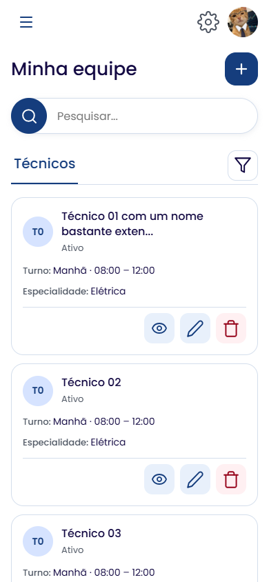
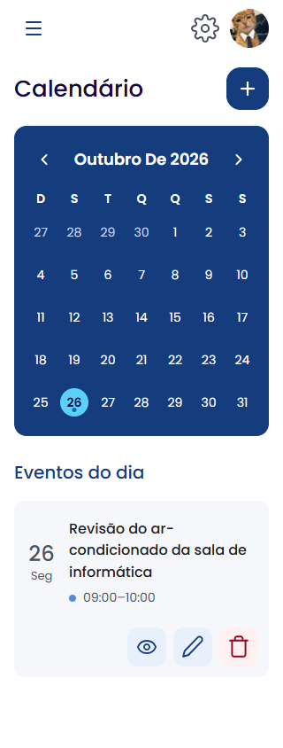
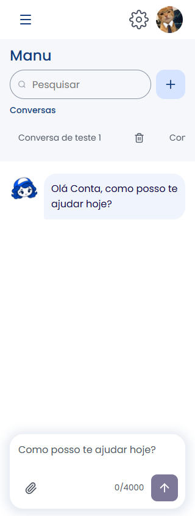
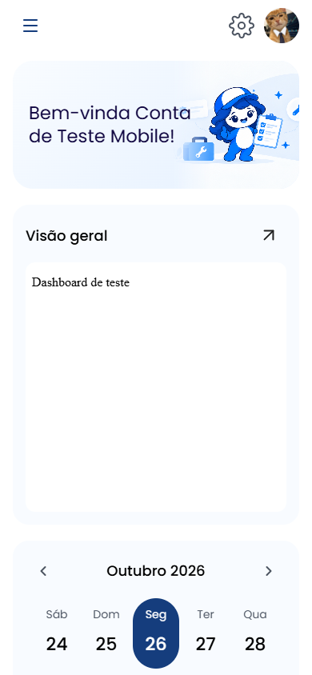

# Revisão mobile — 26/10/2026

Atividade vinculada à [Issue #12](https://github.com/Fixa-Inter/segundo-aplicacao-website/issues/12), sobre a base `7cf1c8f`, na branch `feature/integracao-ia-manu`. Testes executados em 26/10/2026, horário de São Paulo, com Edge e toque emulado.

## Alterações

- Equipe e Calendário: componente compartilhado `AddRecordButton`; até 600px, botão de 48×48px com somente o “+”. Nome acessível e retorno de foco permanecem disponíveis. Desktop conserva ícone e texto.
- Equipe: título e adicionar na mesma linha; cartões separados, metadados legíveis, ações com fundo e alvos de toque de pelo menos 44×44px. Removidos os rótulos visuais repetidos “Nome” e “Ações” dos cartões. RH mantém Gestores primeiro e Técnicos em outra aba.
- Filtro compacto com ícone e indicação de filtros ativos. Paginação longa rola dentro de sua própria faixa, sem alargar a página.
- Calendário: corrigida a sobreposição dos dias em 320px; setas maiores, números mais legíveis e ações dos eventos com espaçamento.
- Home: saudação e imagem ajustadas à largura; setas do mês e acesso ao evento com área de toque maior.
- Manu: busca e novo chat lado a lado; novo chat somente com “+” no layout compacto. Histórico ocupa menos altura e pode rolar. Campo de mensagem permanece dentro da área visível em 320×667, 390×500 e 844×390. Botões de envio, anexos e exclusão maiores.
- Perfil, formulários e preferências: ações de cancelar/salvar distribuídas na largura disponível; opção de tema e campos ajustados. Revelar senha no login passa a 44×44px.
- Cabeçalho: avatar de 44×44px, menos espaço vazio e consideração das áreas seguras do aparelho.

O ponto de corte dos botões de criação de registros é 600px; a Manu mantém seu layout compacto até 900px. Serviços HTTP, permissões e contratos dos backends não foram alterados.

## Verificação

| Checagem | Resultado |
| --- | --- |
| `npm run format:check` | Aprovado |
| `npm run lint` | Aprovado |
| `npm test` | 117 aprovados |
| `npm run build` | Aprovado |
| `npm run test:browser` | 21 aprovados: 13 de interface/toque e 8 de ciclo dos hooks |
| axe-core | 80 cenários, sem violações detectadas nos critérios executados |
| Transbordamento horizontal da página | Não observado nos cenários executados |
| Erros JavaScript e chamadas inesperadas | Nenhum nos cenários controlados |

As verificações incluem 320, 360, 390 e 430px, modo paisagem 844×390 e desktop 1440×960. Conferência adicional dos botões e da grade do calendário em 601, 768, 900 e 901px não encontrou dias sobrepostos.

Os testes duráveis estão em [mobile-layout.test.mjs](../tests/browser/mobile-layout.test.mjs) e usam [management-fixture.mjs](../tests/browser/management-fixture.mjs). Cobrem navegação, abas de RH, filtro, detalhes, edição/descarte, confirmação de desativação e retorno de foco; evento e navegação do calendário/Home; envio e encerramento de chat; paginação até a décima página; menu, perfil, tema, idioma inglês e exibição de senha. O relógio da fixture é fixo para os eventos de outubro de 2026.

As APIs e o iframe são interceptados com dados sintéticos. Não há alteração de registros reais, envio a serviços da AWS ou certificação do conteúdo interno do Databricks nesta rodada.

## Alvos de toque e limites

A meta aplicada aos principais controles é 44×44px; criação de registro e novo chat usam 48×48px no layout compacto. Em 320px, cada dia do calendário tem aproximadamente 36×44px para caberem sete colunas sem sobreposição.

A referência de 44×44px corresponde ao [critério aprimorado de alvos da WCAG, nível AAA](https://www.w3.org/WAI/WCAG22/Understanding/target-size-enhanced/). O [critério mínimo da WCAG 2.2, nível AA](https://www.w3.org/WAI/WCAG22/Understanding/target-size-minimum/) tem outros limites e exceções. As 80 análises axe executaram as tags WCAG 2 A/AA, 2.1 A/AA e 2.2 AA. Resultado automático sem violações não certifica conformidade integral.

Não foram usados aparelho físico, teclado virtual real, Safari/iOS ou leitor de tela. Acesso/autenticação dos serviços publicados e conteúdo dos iframes exigem validação própria. As pendências de DAD e publicação continuam na [matriz](MATRIZ_REQUISITOS.md).

## Evidências

[Resumo das verificações](evidencias/mobile-2026-10-26/resumo.json).

| Equipe em 390px | Calendário em 320px |
| --- | --- |
|  |  |

| Manu em 320px | Home em 390px |
| --- | --- |
|  |  |
